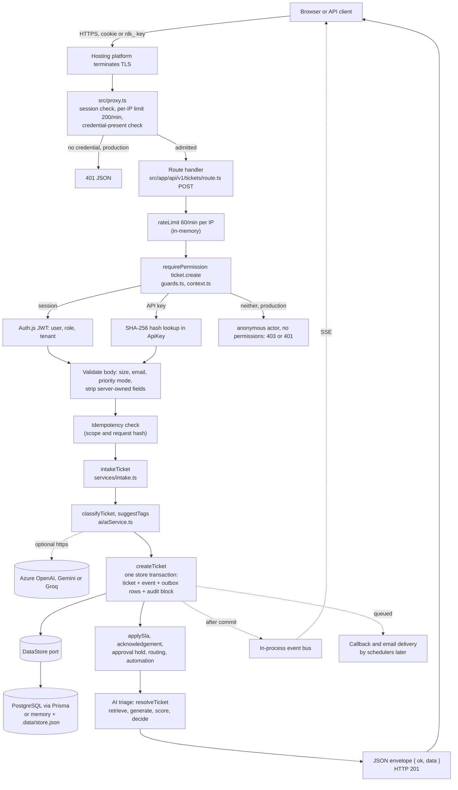

# Netlink Support: architecture audit

Reverse-engineered from the repository at commit [`c0d86aa`](https://github.com/dhwajdhruvkar/ticket-management-integration/tree/c0d86aa14de4f19dac02a307b38c767dd417684c) (branch `claude/nextjs-arch-lens-mapping-5913fb`, clean worktree). Nothing in application code, dependencies or configuration was changed; this folder is the only addition.

**Labels used throughout**

| Label | Meaning |
|---|---|
| **Existing** | Read directly in code or configuration. A file path and symbol is cited. |
| **Inferred** | A reasonable conclusion from several files, not observed running. The reasoning is stated. |
| **Proposed** | A recommendation. It does not exist in the repository. |
| **Unknown** | Could not be established from the repository. Listed under [What was not inspected](#what-was-not-inspected). |

## What the system is

**Existing.** A multi-tenant internal IT and HR service desk (`package.json` name `netlink-support`). It is one Next.js 16.3.7 App Router application (React 19.0.0, TypeScript 5.9.3 strict) with a hand-built REST API under `src/app/api/v1`, webhook receivers under `src/app/api/webhooks`, Auth.js v5 beta sessions, a Prisma 6.19.3 data layer over PostgreSQL, and an in-memory fallback so it runs with no infrastructure. 235 tracked files under `src/`, 79 route handler files exposing 118 HTTP handlers, 34 Prisma models, 50 Vitest files with 298 `it`/`test` calls.

The ticket pipeline, ITIL-style priority, SLA clocks, AI knowledge-base triage, a Service Desk-to-department "bucket" workflow, a tamper-evident audit chain and machine API keys with signed callbacks are all implemented in `src/server`.

## Documentation index

| Document | What it answers |
|---|---|
| [system-context.md](system-context.md) | Who uses it, which outside systems it depends on, and what each is for |
| [application-architecture.md](application-architecture.md) | Folder and module structure, Server vs Client Components, component responsibilities, dependency boundaries, request lifecycle |
| [data-architecture.md](data-architecture.md) | Schema, relationships, the DataStore port, migrations, data flows |
| [api-reference.md](api-reference.md) | Every discovered endpoint, its guard and contract conventions |
| [security-architecture.md](security-architecture.md) | Authentication, roles, tenant isolation, webhooks, secrets, controls and gaps |
| [deployment-and-runtime.md](deployment-and-runtime.md) | Build, CI, hosting, environment, background execution, scaling behaviour |
| [architecture-decisions.md](architecture-decisions.md) | Confirmed and inferred decisions, plus proposed ADRs |
| [risks-and-recommendations.md](risks-and-recommendations.md) | Verified defects, potential risks and a prioritised roadmap |
| [diagrams/](diagrams/) | Arch-lens diagrams (HTML, interactive) and their generated narrative |
| [netlink-support.analysis.json](netlink-support.analysis.json) | The evidence-carrying model the Arch-lens diagrams were compiled from |

## Diagram index

Arch-lens diagrams are compiled from [`netlink-support.analysis.json`](netlink-support.analysis.json) (42 components, 123 relations, 12 questions). Open the `.html` files in a browser. Mermaid diagrams are inline in the documents above.

| Required view | Arch-lens diagram | Mermaid |
|---|---|---|
| System context and external integrations | [landscape](diagrams/landscape.architecture.html), [integrations](diagrams/integrations.architecture.html) | [system-context.md](system-context.md) |
| Application containers and major components | [landscape](diagrams/landscape.architecture.html), [layering](diagrams/layering.architecture.html) | [application-architecture.md](application-architecture.md) |
| Module dependencies and boundaries | [layering](diagrams/layering.architecture.html) | module graph and the import-cycle group in [application-architecture.md](application-architecture.md) |
| Key request and data flows | [ticket-create](diagrams/ticket-create.sequence.html), [inbound](diagrams/inbound.architecture.html), [delivery](diagrams/delivery.architecture.html), [background](diagrams/background.architecture.html) | request journey below |
| Authentication and authorization | [auth-flow](diagrams/auth-flow.sequence.html), [identity](diagrams/identity.architecture.html) | webhook verification in [security-architecture.md](security-architecture.md) |
| Critical business workflows | [ticket-create](diagrams/ticket-create.sequence.html), [ai-resolution](diagrams/ai-resolution.sequence.html), [workflow-transition](diagrams/workflow-transition.sequence.html) | bucket phase machine in [application-architecture.md](application-architecture.md) |
| Runtime and deployment | [deployment](diagrams/deployment.architecture.html) | topology in [deployment-and-runtime.md](deployment-and-runtime.md) |
| Database relationships | none (Arch-lens models components, not tables) | two ER diagrams in [data-architecture.md](data-architecture.md) |

The Arch-lens renderer drops components that do not fit a view. Each diagram's card lists what it left out, and the generated [diagrams/README.md](diagrams/README.md) repeats that with the long-form narrative for each question.

## Headline findings

Full detail, evidence and ranking are in [risks-and-recommendations.md](risks-and-recommendations.md).

**Verified defects and drift** (each confirmed in code or by script):

1. Sentry error reporting never runs: the logger calls `globalThis.__sentryCapture`, which nothing sets (`src/server/observability/logger.ts:102`).
2. The legacy scheduler has no trigger on serverless hosting, and the workflow sweep endpoint has no caller in the repository (`vercel.json` defines no crons; `src/server/jobs/scheduler.ts:279`). The docs name an external cron-job.org schedule and record that it was not configured at the last release (`docs/SERVICE_DESK_WORKFLOW.md:108`, `docs/IMPLEMENTATION_STATUS.md`), so whether it runs is unknown. The first half is an inference; the second is verified.
3. Inbound webhooks, email and chat all land in the first tenant in the list: `currentTenantId()` and `defaultTenantId()` fall back to `tenants[0]` (`src/server/context.ts`, `src/server/data/index.ts`).
4. A 16-file runtime import cycle exists, hidden by lazy `import()` calls (found by script; no cycle in static imports).
5. `databaseBlob.ts` reaches the Prisma client directly, bypassing the DataStore port the rest of the code honours (confirmed by Arch-lens `enforce`).
6. The pgvector index is provisioned but never queried; search ranks every article in process.
7. The hand-written OpenAPI document omits five route files; `/api/v1/health` reports version `2.0.0` while `package.json` says `1.0.0`; the README names `middleware.ts` but the file is `src/proxy.ts`.

**Strengths worth keeping:** tenant-scoped guards that answer 404 not 403; hash-only API keys; a hash-linked audit chain written inside the caller's transaction; compare-and-set workflow transitions; a leased, retrying email outbox; SSRF-guarded signed callbacks; production environment gates that refuse to boot on demo settings.

## How a request travels through the application

This is the end-to-end journey, using the most important write, filing a ticket with `POST /api/v1/tickets`. It is **Existing** behaviour, read from the files cited. The matching interactive diagram is [ticket-create](diagrams/ticket-create.sequence.html).

Step by step, with the files that do the work:

1. **Edge gate.** The request reaches `src/proxy.ts`. Pages need an Auth.js session or are redirected to `/signin`. For `/api/v1/*` the proxy applies an in-memory fixed-window limit of 200 requests per minute per IP, then `decideApiV1Access` (`src/server/auth/apiGateway.ts`) admits the request if it carries a session or an `nlk_` key, or if demo mode is on, or if the path is `/api/v1/health`. It does not verify the key and does not authorize anything.
2. **Route handler.** `src/app/api/v1/tickets/route.ts` `POST` applies `rateLimit` (60 per minute per IP, again in memory), then `requirePermission(req, "ticket.create")`.
3. **Identity and tenant.** `guards.ts` calls `actorContext`, which runs `currentTenantId` and `currentActor` from `context.ts`: the Auth.js session first, then an API key (its SHA-256 is looked up in the `ApiKey` collection), then, only in demo mode, `x-actor` and `x-tenant` headers. A presented but invalid key becomes an actor with role `none`; `can()` then fails and the guard returns 401 for keys, 403 otherwise.
4. **Validation.** The handler checks sizes (subject 300, body 50,000), validates the email with zod, strips fields only the server may set (`requesterId`, idempotency hashes, `integrationKeyId`, `customFields`), forces requesters to file as themselves and forces automatic priority for them, and requires an override reason for manual priority.
5. **Idempotency.** `ticketIdempotencyMetadata` and `findIdempotentTicket` (`services/idempotencyService.ts`) return an earlier ticket when the same scoped key and request body is replayed.
6. **Intake.** `intakeTicket` (`services/intake.ts`) resolves the requester from the store, classifies if category or priority is missing (an LLM call when a provider is configured, otherwise a deterministic offline path), applies the VIP urgency floor, merges AI tags, then calls `createTicket`.
7. **Persistence.** `createTicket` (`services/ticketService.ts:196`) opens one `store.transaction`. Inside it: the ticket row, a `created` event, the lifecycle outbox rows (`queueLifecycle`, which writes nothing unless the ticket is in the bucket workflow), and the `ticket.ingested` audit block (`appendAudit`). After commit it queues a `ticket.created` callback for subscribed API keys.
8. **Policies.** Back in intake: SLA due dates (`slaService.applySla`), the acknowledgement notification (skipped for workflow tickets), an approval hold for catalog items that need it, then `processTicketPipeline`: group routing, automation rules, and finally AI triage (`ai/resolver.ts` `resolveTicket`) for open incidents and requests. Routing and triage run under `withRetry`; a step that keeps failing is written to the audit chain rather than failing the request.
9. **Response.** The route returns `{ ok: true, data }` with status 201. Errors use `{ ok: false, error }`.
10. **After the response.** `mutateTicket` and the Notifier publish `ticket.updated` and `notification` events on the in-process bus; `/api/v1/events` pushes them to open SSE connections. Queued emails and callbacks are sent later by the schedulers, not in the request.

**Persistence touched:** PostgreSQL (or the memory store) for tickets, events, outbox rows, audit blocks, notifications, resolutions and citations. **External services touched, only when configured:** an LLM provider for classification and triage; Microsoft Graph, Brevo, Slack or Teams for notifications. Nothing outside the process is required for a ticket to be created.

For a read such as `GET /api/v1/tickets/:id` the path is shorter: proxy, route, `requirePermission`, `loadTicket` (tenant-scoped read that answers 404 across tenants), `getTicketView`, JSON. Webhooks skip the proxy's API gate and authenticate themselves ([security-architecture.md](security-architecture.md#inbound-webhooks)).

## Method and limits

- Source read: `package.json`, `package-lock.json` (versions), `next.config.mjs`, `vercel.json`, `Dockerfile`, `docker-compose.yml`, `.github/workflows/ci.yml`, `prisma/schema.prisma` and migration names, `src/**` (entry points, config, auth, guards, services, AI, channels, jobs, notify, storage, data adapters), the check scripts, and the test configuration.
- Machine analysis: Arch-lens `validate`, `check` (267 evidence citations, 0 gone) and `enforce` (2 constraints hold; one real violation found and recorded as a fact before the constraint was corrected); a script over every `src` import for cycles; a script over every route file for methods and guards; a script over `schema.prisma` for the ER diagrams.
- Not run: the test suite, type-check, lint and production build. No server was started. All behavioural statements come from reading code.

### What was not inspected

- The hosted deployment (`https://netlink-support.vercel.app/` per `README.md`), its environment variables, its Neon database contents, Vercel project settings and any cron configured in the Vercel dashboard. **Unknown.**
- Real secrets: no `.env` file is committed; only `.env.example` and `.env.production.example` were considered.
- `qa/*.xlsx`, `docs/manual-testing/*.xlsx` (binary spreadsheets), the root `*.html` explainers (`overview.html`, `workflow*.html`, `gaps.html`, `comparison.html`), `EXPLANATION.md`, `instruction.md`, `tasks/**`, and vendored `.agents/skills/**`. They are documentation or tooling, not runtime. `docs/IMPLEMENTATION_STATUS.md` (908 lines) and `docs/SERVICE_DESK_WORKFLOW.md` were searched for cron, CI and release status and read at those passages only; their statements about the hosted deployment are cited as **documented, not verified**.
- `src/components/**` were read for their server imports and structure, not line by line. UI behaviour and styling were not assessed.
- Migration SQL bodies were listed, not audited; the schema file is taken as the current model.
- Prisma runtime behaviour (query plans, connection pooling) and PostgreSQL index effectiveness: **Unknown**.
- The Arch-lens renderer used the project's vendored archify 3.0.1 through a small compatibility shim kept outside the repository, because Arch-lens 0.5.5 emits specs that archify 3.0.1 rejects. The shim adds the required `meta.output` field and 24px of canvas height to sequence diagrams; it changes no content. All twelve passed the renderer's nine artifact checks and browser containment at several viewports. Five were then viewed as screenshots: `ticket-create` and `auth-flow` are clean; `landscape`, `layering` and `background` pass the checks but have long routed edges and some overlapping or ambiguously placed edge labels (for example the "browser calls" and "poll Graph mailbox" labels sit away from their arrows), so read them with the node and relation lists in the generated [diagrams/README.md](diagrams/README.md) beside them. The other seven (`inbound`, `identity`, `delivery`, `integrations`, `deployment`, `ai-resolution`, `workflow-transition`) were not individually viewed. The screenshot and receipt sidecar files the tool wrote were deleted to keep the folder small; rerunning the render recreates them.
