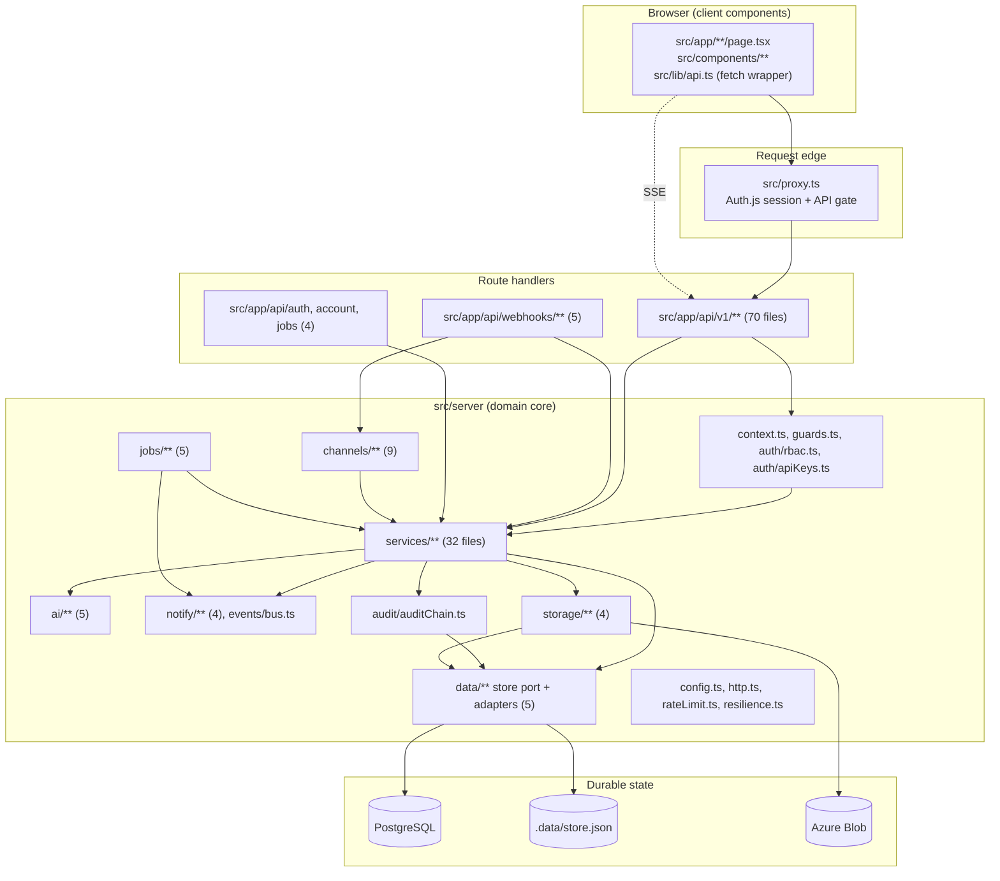
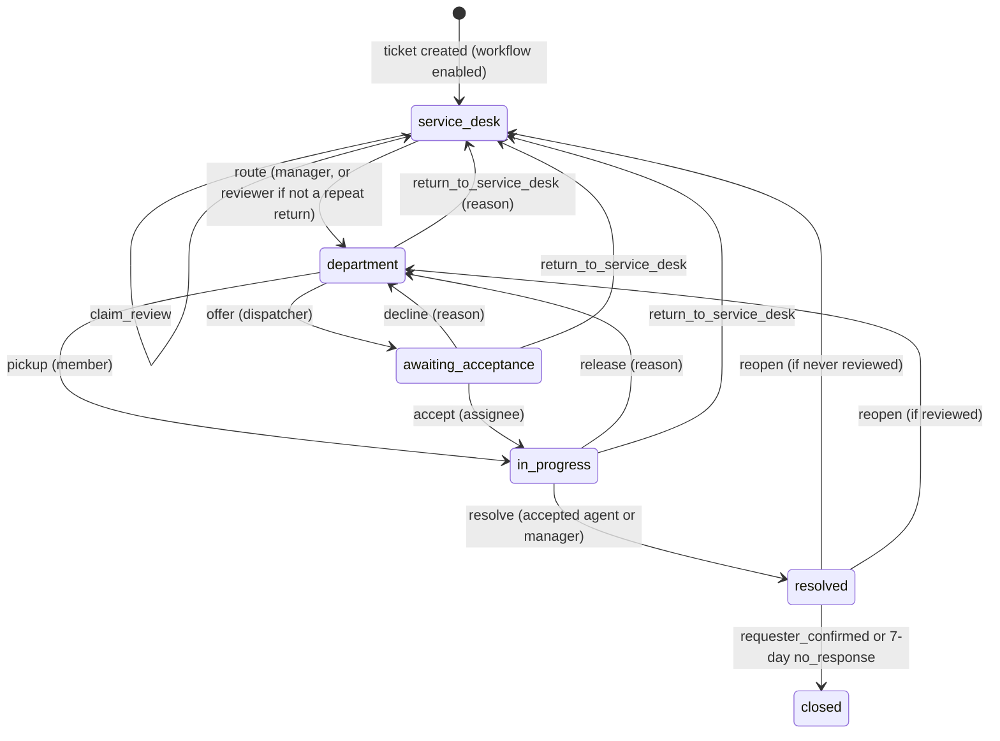

# Application architecture

How the code is organised, what each part is answerable for, and where the boundaries are. Labels: **Existing** (read in code), **Inferred**, **Proposed**, **Unknown**. Interactive diagrams: [landscape](diagrams/landscape.architecture.html), [layering](diagrams/layering.architecture.html), [background](diagrams/background.architecture.html), [delivery](diagrams/delivery.architecture.html).

## Shape of the application

**Existing.** A single Next.js App Router application, a "full-stack monolith" in the README's words. There is no Pages Router, no `getServerSideProps`, no Server Actions (no `"use server"` anywhere in `src`), no separate worker process and no external queue. The browser UI and the API live in one deployable, and background work runs inside the same process or is triggered by an HTTP call into it.

## Folder and module inventory

Counts are tracked files (`git ls-files`).

| Path | Files | Responsibility | Server or client |
|---|---|---|---|
| `src/app/*/page.tsx`, `layout.tsx`, `template.tsx` | 18 pages | Routes, layout, global providers | 8 pages are Client Components, 10 are thin Server Components that render a client component |
| `src/app/api/v1/**` | 70 | The REST API | Server |
| `src/app/api/webhooks/**` | 5 | Inbound webhooks (Brevo, Freshdesk, generic, Slack, Zendesk) | Server |
| `src/app/api/auth`, `api/account`, `api/jobs` | 4 | Auth.js handler, account setup, ticket confirmation, workflow cron | Server |
| `src/components/**` | 33 | Screens and widgets: `AppShell`, `TopBar`, `TicketsExplorer`, `BucketWorkspace`, `TriageView`, `ConversationThread`, `SettingsView`, … | Client (41 of 55 `.tsx` files carry `"use client"`) |
| `src/lib/**` | 6 | Browser helpers: `api.ts` fetch wrapper, `useLiveRefresh`, `liveTicket`, `ticketFilters`, hints, static article data | Client |
| `src/shared/**` | 5 | Code used by both sides: `rbac`, `workflow` types, `priority`, `attachments`, `publicDemoUsers` | Both |
| `src/server/services/**` | 32 | Business logic per area | Server |
| `src/server/ai/**` | 5 | Classifier, RAG resolver, vector search, embeddings, LLM gateway | Server |
| `src/server/channels/**` | 9 | Email (Graph, Brevo), Slack, Teams, webhook adapters and signature checks | Server |
| `src/server/notify/**` | 4 | Notifier, templates, durable workflow outbox, acknowledgement tokens | Server |
| `src/server/jobs/**` | 5 | Scheduler, locks, durable lease, workflow maintenance and retention | Server |
| `src/server/data/**` | 5 | DataStore port, Prisma and memory adapters, seed, factory | Server |
| `src/server/domain/**` | 3 | Row models, id helpers, priority matrix | Server |
| `src/server/auth/**` | 4 | RBAC matrix, API keys, edge API gateway, password hashing | Server |
| `src/server/audit`, `events`, `storage`, `observability`, `integrations` | 1, 1, 4, 1, 1 | Audit chain, event bus, blob adapters, logger, Teams presence | Server |
| `src/server/*.ts` | 8 | `config`, `context`, `guards`, `http`, `rateLimit`, `sharedRateLimit`, `resilience`, `workflowOpenApi` | Server |
| `src/auth.ts`, `auth.config.ts`, `proxy.ts`, `instrumentation.ts` | 4 | Auth.js, the request gate, boot hook | Server |
| `prisma/` | schema, 7 migrations, seed, one raw SQL file | Persistence definition | n/a |
| `tests/` | 50 | Vitest files, memory driver | n/a |

## Entry points

**Existing.**

| Entry | File | What it does |
|---|---|---|
| Boot hook | `src/instrumentation.ts` `register()` | In the Node runtime only, calls `startScheduler()` |
| Network gate | `src/proxy.ts` | Wraps Auth.js; matcher covers pages, `/api/v1/:path*` and `/api/auth/callback/demo`; excludes other `/api` paths, static assets, `/signin`, `/setup-account`, `/ticket-confirmation`, `/legal` |
| Root layout | `src/app/layout.tsx` | Inter font, theme cookie, then `SessionProvider` → `ThemeProvider` → `PersonaProvider` → `ToastProvider` → `AppShell` |
| Pages | `src/app/**/page.tsx` | See below |
| Route handlers | `src/app/api/**/route.ts` | 79 files, 118 handlers; [api-reference.md](api-reference.md) |
| Auth.js | `src/app/api/auth/[...nextauth]/route.ts` | Re-exports `handlers` from `src/auth.ts` |

Pages: `/` (dashboard), `/portal`, `/tickets`, `/tickets/[id]`, `/triage`, `/problems`, `/changes`, `/assets`, `/knowledge-base`, `/analytics`, `/audit`, `/settings`, `/profile`, `/signin`, `/setup-account`, `/ticket-confirmation`, `/legal/privacy`, `/legal/acceptable-use`.

## Server Components, Client Components, Server Actions, middleware

- **Existing: data fetching is entirely client-side.** The Server Component pages (`audit`, `knowledge-base`, `profile`, `settings`, `tickets`, `triage`, `setup-account`, `signin`, `legal/*`) do not read data; `signin/page.tsx` imports only `config` to decide which sign-in options to show. Every Client Component fetches `/api/v1/*` through `apiGet`/`apiSend` in `src/lib/api.ts` with `cache: "no-store"`.
- **Existing: no Server Actions.** Mutations are `fetch` calls to route handlers. There is no `revalidatePath`, `revalidateTag`, `unstable_cache` or `"use cache"` anywhere in `src`. 77 of the 79 route files export `dynamic = "force-dynamic"` (all except the Auth.js handler and `workflow/retry-emails`).
- **Existing: `src/proxy.ts` is the Next.js 16 network-boundary file** (the README still calls it `middleware.ts`). Its runtime is **Unknown**: the code keeps the Auth.js config import-free of the database (`auth.config.ts` says "edge-safe") but nothing in the repository states which runtime executes it.
- **Existing: type-only coupling.** Client components import types from server modules (for example `BucketWorkspace.tsx` imports `WorkflowBoard` from `services/workflowBoard`). All such imports use `import type`, which TypeScript erases; a script over every `src` import found 0 client files with a runtime import of a server module.

## Component responsibilities

The component model behind the diagrams is [`netlink-support.analysis.json`](netlink-support.analysis.json); each entry there has a one-sentence responsibility and cited evidence. The table groups them.

| Component | Responsibility | Key symbols |
|---|---|---|
| Edge proxy | Session redirect for pages; credential-present check and 200/min soft limit for the API | `src/proxy.ts`, `decideApiV1Access` |
| Context and guards | Resolve actor and tenant; check RBAC; 404 across tenants | `actorContext`, `requirePermission`, `loadTicket`, `assertTenant`, `can` |
| REST API | Validate, call one service, shape `{ ok, data }` | `ok`, `fail`, `paginated`, `parseBody` in `src/server/http.ts` |
| Unified intake | Fixed pipeline for every new ticket | `intakeTicket`, `processTicketPipeline` |
| Ticket services | Ticket rows, patches, messages, events | `createTicket`, `mutateTicket`, `addMessage`, `recordEvent` |
| Bucket workflow | Service Desk and department queues with guarded transitions | `transitionWorkflow`, `workflowMutationPatch`, `monitorWorkflowTicket` |
| SLA, routing, rules | Clocks, group routing, automation, approvals | `applySla`, `slaStatus`, `routeTicketToGroup`, `runAutomationsSafe`, `requestTicketApproval` |
| AI resolver and gateway | Classify; retrieve, generate, score, decide; provider fallback | `classifyTicket`, `resolveTicket`, `generateAnswer`, `embed` |
| Channel adapters | Mailbox, Slack and Teams to intake | `processInboundEmail`, `pollMailbox`, `handleSlackEvent`, `handleTeamsActivity` |
| Notifier and outbox | In-app record plus email or chat; durable retried email for workflow | `notify`, `drainWorkflowOutbox` |
| Event bus | Fan events out to SSE connections in-process | `publishEvent`, `subscribeEvents` |
| Audit chain | Hash-linked audit blocks | `appendAudit`, `verifyChain` |
| Outbound callbacks | Signed, SSRF-guarded customer callbacks | `queueTicketWebhookEvent`, `deliverWebhookDelivery` |
| Schedulers | SLA sweeps, digests, polling; workflow sweep under a lease | `startScheduler`, `runWorkflowMaintenance` |
| DataStore port | Collection interface, transactions, compare-and-set | `DataStore`, `Collection`, `getStore`, `pageCollection` |
| Attachment storage | Blob port with local, Azure and database adapters | `getBlobStore`, `saveAttachment` |
| Config | Environment read once; feature flags | `config`, `resolveAuthMode`, `resolveAttachmentStorage` |

The `domain` group in the model (knowledge base, problems, changes, assets, users, organizations, metrics, PDF reports) appears in no diagram: it has no distinguishing relationships beyond the common ones.

### Bucket workflow phase machine

**Existing** (`src/shared/workflow.ts` `TicketWorkflow.phase`, `src/server/services/workflowService.ts` `transitionWorkflow`). Enabled per tenant by `workflowSettings.enabled`; applies to incidents and service requests only. Interactive sequence: [workflow-transition](diagrams/workflow-transition.sequence.html).

Guards on top of the machine: every transition is one `store.transaction`; the ticket write is `updateIf(workflowVersion)`; a ticket returned twice or returned from a target group cannot be re-routed by a non-manager; the legacy PATCH, automation and AI paths are blocked from changing assignment or workflow state (`workflowMutationPatch`); AI may only suggest, never auto-resolve (`ai/resolver.ts` `decide`).

## Dependency boundaries

**Existing**, verified by Arch-lens `enforce` and a script over every import in `src`.

| Rule | Status |
|---|---|
| Only the DataStore port reaches the Prisma adapter | **Violated once**: `src/server/storage/databaseBlob.ts:9` imports `prismaClient` from `data/prismaStore.ts`. The constraint in the model was corrected to name it. |
| The browser never reaches durable state except through the API | Holds: no client file runs a server import; no client reaches the database |
| Services should not import route handlers or UI | Holds (no such import found) |
| Static import graph is acyclic | **Holds only because of lazy `import()`**: see below |

### Import cycle hidden by dynamic imports

A strongly-connected group of 16 files exists when `await import()` edges are counted, and none when only static imports are. The group:

`ai/resolver`, `channels/brevoEmail`, `channels/emailIngest`, `channels/emailThreading`, `channels/slack`, `notify/notifier`, `notify/templates`, `notify/workflowOutbox`, `services/agentActions`, `services/approvalService`, `services/attachmentService`, `services/automationService`, `services/groupService`, `services/intake`, `services/ticketService`, `services/workflowService`.

The edges that close it are nine of the ten `await import()` calls in `src/server` (the tenth, `data/index.ts:15`, lazily loads the Prisma adapter and is not part of a cycle): `ticketService.ts:381` → `automationService`, `automationService.ts:278` → `ai/resolver`, `approvalService.ts:148` → `intake`, `resolver.ts:220` → `agentActions`, `notifier.ts:63,75,118` → Brevo and Slack, `workflowOutbox.ts:60,63`. Two direct two-file cycles exist: `approvalService` ↔ `intake` and `automationService` ↔ `ticketService`. The lazy imports keep the bundler and runtime happy but hide the coupling from readers. See [risks V4](risks-and-recommendations.md#v4-hidden-runtime-import-cycle).

### Layering as practised

Routes call guards and services; services call the audit chain and the DataStore port; the port builds one adapter. The practised exceptions: sixteen route files call `getStore()` themselves; `guards.ts` imports `ticketService`; `agentActions` (ticket layer) imports `auth/rbac` and `notify/templates`; `idempotencyService` imports `context`. None of these is a defect on its own; together they show the layers are conventions, not enforced.

## State, forms, validation, data fetching

| Concern | Existing approach | Evidence |
|---|---|---|
| Client state | React `useState`/`useEffect`; four small contexts (`Theme`, `Persona`, `Toast`, `Shell`); no Redux, SWR or React Query in `package.json` | `src/components/*.tsx` |
| Server state | Refetch via `apiGet` and `apiGetAll` (pages through `meta.totalPages`); live refresh by SSE with a polling fallback | `src/lib/api.ts`, `src/lib/useLiveRefresh.ts`, `src/lib/liveTicket.ts` |
| Forms | Controlled components posting JSON or `FormData` with `apiSend` / `apiSendForm`; no form library | `TicketComposer.tsx`, `AttachmentPicker.tsx` |
| Validation | **Server only, with zod 4.4.3** (`parseBody`, inline `safeParse`, `WorkflowActionSchema`). No client file imports zod. | `src/server/http.ts`, route files |
| Pagination | Server-side `page`, `pageSize`, `sortBy` allow-lists; `{ ok, data, meta }` | `parsePagination`, `paginated` |
| Live updates | Four `new EventSource("/api/v1/events")` call sites (`TopBar`, `TriageView`, `useLiveRefresh`, `liveTicket`), so one tab can hold more than one stream | grep |

## Caching, revalidation, background processing, file storage

- **Caching: none at the framework level.** No Next.js data cache use; responses are `force-dynamic`; the client sends `cache: "no-store"`. The in-process `globalThis` singletons are the only caches: the store, the event bus, rate-limit windows and job locks. See [data-architecture.md](data-architecture.md#caching).
- **Background processing:** two runners, described with the lease and retry mechanics in [deployment-and-runtime.md](deployment-and-runtime.md#background-execution). Interactive: [background](diagrams/background.architecture.html).
- **File storage:** `blobStore.ts` selects Azure Blob, database (`AttachmentBlob` table, 4 MB cap) or local disk (demo only); otherwise attachments are disabled.

## Error handling and observability (summary)

- API errors use `{ ok: false, error }` with a status (`fail`). Routes `catch` known service errors (`WorkflowError`, `OrganizationServiceError`, `accountAccessError`) and rethrow the rest.
- Post-create steps use `withRetry` and write a `<step>.failed` audit block when retries are exhausted (`src/server/resilience.ts`); scheduler ticks use `runWithRetry` and write `job.failed`.
- Logging is one redacted JSON line per event (`src/server/observability/logger.ts`). The Sentry hook is inert ([V1](risks-and-recommendations.md#v1-sentry-reporting-is-inert)).
- The App Router has no `error.tsx`, `loading.tsx`, `not-found.tsx` or `global-error.tsx`; Next.js defaults apply.

Further detail on security controls is in [security-architecture.md](security-architecture.md); build and CI are in [deployment-and-runtime.md](deployment-and-runtime.md).
