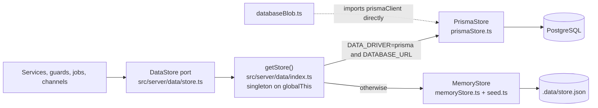
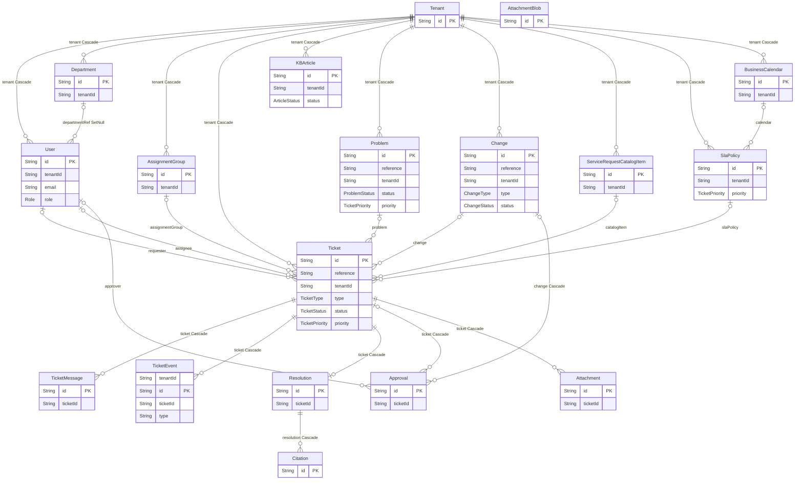
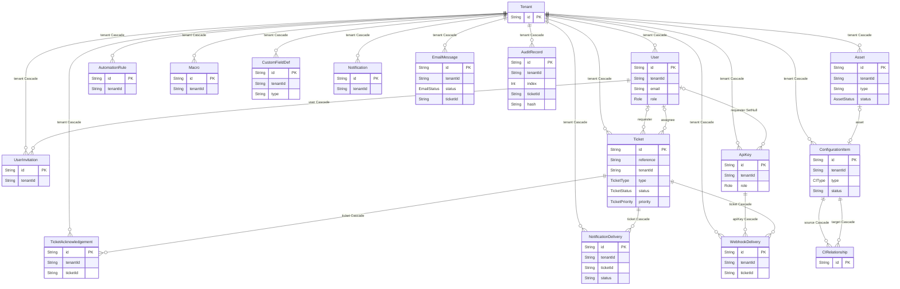

# Data architecture

Database technology, schema, access layer, migrations and data flow. Labels: **Existing**, **Inferred**, **Proposed**, **Unknown**. Everything about tables comes from `prisma/schema.prisma`; nothing here is invented. There is no Arch-lens diagram for tables, so the relationships are Mermaid ER diagrams generated by a script from the schema (49 relations, 34 models, 20 enums).

## Technology

| Item | Existing | Evidence |
|---|---|---|
| Database | PostgreSQL, with the `pgcrypto` and `vector` extensions declared | `prisma/schema.prisma` `datasource db` |
| ORM | Prisma 6.19.3 (`prisma-client-js`, preview feature `postgresqlExtensions`) | `package.json`, `package-lock.json` |
| Connection | `DATABASE_URL` for the client, `DIRECT_URL` as `directUrl` for migrations | `schema.prisma`, `.env.example` |
| Migrations | 7 Prisma migrations, `prisma migrate dev`; production schema verification by script | `prisma/migrations/*`, `scripts/verify-production-schema.sql` |
| Fallback store | In-memory collections persisted whole to `.data/store.json` after every mutation | `src/server/data/memoryStore.ts` |
| Production host | Neon is required by the environment check (host must end `.neon.tech`, `sslmode=require`) | `scripts/check-production-environment.cjs` |

Migration history (names only, SQL bodies were not audited): `20260818075249_init`, `20260821143000_ticket_soft_delete`, `20260824150000_phase15_org_onboarding`, `20260901150000_integration_hardening`, `20260901170000_verified_organization_deletion`, `20260930150000_service_desk_workflow`, `20261014090000_attachment_message_and_blob`.

## Data access layer

**Existing.** One abstraction, two adapters.

- **Port.** `DataStore` exposes 33 typed `Collection<T>` properties (`tickets`, `users`, `articles`, `audit`, `apiKeys`, `notificationDeliveries`, …) and `transaction()`. A collection has `list(where, options)`, `get`, `create`, `update`, `updateIf` (atomic compare-and-set), `remove`, `count`. `where` is a **shallow equality filter only** (`field === value`); anything richer is composed in services (`store.ts` header). `pageCollection` returns a page and the unpaginated count together.
- **Prisma adapter.** Each collection wraps a Prisma delegate (`PrismaCollection<any>`), converts `Date` to ISO strings on read, strips `undefined` from patches so both drivers behave alike, and implements `updateIf` as `updateMany({ where: { ...expected, id } })` succeeding when `count === 1`. `transaction()` runs `$transaction` at **Serializable** isolation with `maxWait` 10 s and `timeout` 30 s (sized for Neon wake-up and PgBouncer queueing) and retries up to three times on Prisma `P2034` and `P2002`.
- **Memory adapter.** Same interface over arrays; seeds demo tenants, users, tickets and articles on first use; flushes the whole dataset to disk on every write. Tests run on it (`vitest.config.ts` sets `DATA_DRIVER=memory`).
- **Singleton.** The store, and the Prisma client (`globalThis.__netlinkPrisma`), are cached on `globalThis` to survive hot reload and be shared per process.
- **Row types.** The TypeScript shapes the services use are hand-written in `src/server/domain/models.ts` (normalised row types, ISO-string dates), separate from the Prisma-generated types. The Prisma delegates are typed `any`, so a mismatch between the two would surface at runtime, not compile time (**Inferred** from the `any` delegates; no mismatch was found in the sample read).

## Schema

### Core ticketing

`Resolution.ticketId` is unique, so a ticket holds at most one AI resolution; a re-run replaces it and its citations (`ai/resolver.ts`).

### Operations, integration and platform

`AuditRecord` has no foreign key to `Ticket` (its `ticketId` is a plain column), and `UserInvitation` links to `User` and `Tenant`. Entities with no relation line here (`AttachmentBlob`, `PublicRateLimit`, `JobLease`) are infrastructure tables described below.

### Entity groups

| Group | Models | Notes |
|---|---|---|
| Tenancy and identity | `Tenant`, `User`, `UserInvitation`, `Department`, `AssignmentGroup` | `User` unique on `(tenantId, email)`; `Tenant` holds `workflowSettings` JSON and an `isInternal` flag; invitations carry hashed one-time tokens with expiry |
| Ticketing | `Ticket`, `TicketMessage`, `TicketEvent`, `Resolution`, `Citation`, `Attachment`, `AttachmentBlob`, `Approval`, `TicketAcknowledgement` | `Ticket` has 65 fields and seven indexes; `workflow` JSON and `workflowVersion` implement the bucket workflow; soft delete through `deletedAt` |
| Knowledge and AI | `KBArticle` | Embeddings are `Float[]` with an `embeddingModel` tag |
| ITIL records | `Problem`, `Change`, `Asset`, `ConfigurationItem`, `CIRelationship`, `ServiceRequestCatalogItem` | CMDB with unique `(sourceId, targetId, kind)` |
| Policy and configuration | `SlaPolicy`, `BusinessCalendar`, `AutomationRule`, `Macro`, `CustomFieldDef` | `SlaPolicy` unique on `(tenantId, priority, name)` |
| Integration and delivery | `ApiKey`, `WebhookDelivery`, `EmailMessage`, `Notification`, `NotificationDelivery` | `EmailMessage` unique on `(tenantId, internetMessageId)` is the inbound de-duplication ledger |
| Audit | `AuditRecord` | Unique `(tenantId, index)` with `prevHash`, `payloadHash`, `hash` |
| Infrastructure | `JobLease`, `PublicRateLimit`, `AttachmentBlob` | Durable job lease, DB-backed rate-limit windows, blob bytes |

### Notable modelling choices (Existing)

- **Soft delete** for tickets (`deletedAt`); operational reads exclude them, reporting reads keep them (`listActiveTickets`, `listTicketsForReporting`).
- **Flat scalar arrays and JSON** instead of join tables for portability across both drivers: `tags`, `ciIds`, `linkedTicketIds` (`Ticket`), `customFields` JSON, `workflow` JSON. The schema comment says this keeps "both data drivers" in one shape. Consequence: these cannot be queried relationally.
- **Cascade deletes** from `Tenant` to nearly everything; `User` deletion sets `Department` to null and `ApiKey.requesterId` to null.
- **Idempotency** columns on `Ticket` (`idempotencyScopeHash` unique, `idempotencyRequestHash`, `integrationKeyId`, `externalTicketId`).
- **Ten models carry no `tenantId`**: `Tenant` (itself), `TicketMessage`, `Resolution`, `Citation`, `Approval`, `CIRelationship`, `Attachment`, `AttachmentBlob`, `PublicRateLimit`, `JobLease`. For the children, tenant isolation depends on the service first loading the parent in the caller's tenant (`loadTicket`, `attachmentService` via `ticketService`). That works while every path does it; there is no database-level enforcement. **Inferred** risk, see [security-architecture.md](security-architecture.md#tenant-isolation).
- **pgvector is not used.** `prisma/sql/001_pgvector.sql` adds a `vector(384)` column and index, but no source file queries it (`src` has no raw SQL beyond the advisory lock in `jobs/lock.ts`). Search ranks articles in process: `vectorSearch.search` loads all published articles of the tenant and computes cosine similarity. **Existing**; risk [V6](risks-and-recommendations.md#v6-pgvector-is-provisioned-but-unused).

## Enumerations

Twenty Prisma enums define the vocabulary: `Role` (super_admin, tenant_admin, manager, agent, requester, ticket_submitter), `TicketType` (incident, service_request, problem, change), `TicketStatus` (new, open, in_progress, pending, auto_resolved, pending_agent, escalated, resolved, reopened, closed, cancelled), `TicketPriority` (critical to very_low), `TicketChannel` (email, portal, chat, api, phone, teams), `ResolutionDecision` (auto_resolve, suggest, escalate), `ChangeStatus` (ten states), `NotificationChannel`, `EmailStatus` and others.

## Data flows

### Write path (ticket)

Request to guard to intake to `createTicket`, which writes in **one Serializable transaction**: `tickets.create`, a `created` `TicketEvent`, the outbox rows (`Notification` plus `NotificationDelivery`, written by `queueLifecycle` only when the ticket is in the bucket workflow) and the `ticket.ingested` `AuditRecord`. After commit it queues a `WebhookDelivery` per subscribed API key. Walk-through: [README, request journey](README.md#how-a-request-travels-through-the-application); diagram: [ticket-create](diagrams/ticket-create.sequence.html).

### Audit chain

`appendAudit` (`src/server/audit/auditChain.ts`) reads the latest block of the tenant, computes `hash = sha256(index|timestamp|actor|action|payloadHash|prevHash)` with a genesis hash for the first block, and inserts inside `store.transaction`, joining the caller's transaction when one is passed. `(tenantId, index)` is unique, so concurrent appends collide and are retried by the transaction wrapper. `verifyChain` recomputes the whole chain and reports the first broken index (`GET /api/v1/audit?verify=1`).

### Read path

Routes read through services or, in sixteen route files, directly through `getStore()`. Lists are paginated server-side. There are no raw joins: relations are stitched in service code (for example `getTicketView` loads messages, events, attachments and the resolution separately).

### Inbound email ledger

`processInboundEmail` writes an `EmailMessage` ledger row **before** processing so a crash cannot ingest the same message twice; then it threads, appends or creates a ticket through intake, and saves attachments.

### Outbox and callbacks

Workflow email is written as `Notification` and `NotificationDelivery` rows in the same transaction as the change; `drainWorkflowOutbox` later claims rows by `updateIf` with a two-minute lease, sends, and marks `sent`, `pending` (with exponential backoff up to one hour) or `failed` after eight attempts. Customer callbacks use `WebhookDelivery` rows with the same claim pattern. Both are at-least-once.

### Retention

`src/server/jobs/workflowRetention.ts` (`cleanWorkflowMetadata`) trims workflow metadata inside the maintenance sweep. Retention rules for other tables (tickets, audit, notifications, emails) were **not found**: **Unknown** whether any exist outside the repository.

## Caching

**Existing.** No application cache layer: no Redis client (REDIS_URL is read and unused), no Next.js data cache, no memoisation of store reads. Per-request repetition is real: `actorContext` runs `currentTenantId` and `currentActor`, each of which may read the store and the session; `intakeTicket` loads all users of a tenant to find the requester; `notify` loads all users to find a recipient's preferences. These are verified code paths; their cost at scale is **Unknown** (not measured).

## Concurrency and integrity guarantees

| Guarantee | Mechanism | Evidence |
|---|---|---|
| Atomic multi-row writes | `store.transaction` at Serializable with retry | `prismaStore.ts` |
| No lost updates on workflow tickets | `updateIf` on `workflowVersion` | `workflowService.ts` |
| No double job runs | `JobLease` row plus pg advisory lock | `durableLease.ts`, `jobs/lock.ts` |
| No double email ingest | Unique `(tenantId, internetMessageId)` plus ledger-first write | `emailIngest.ts`, schema |
| Tamper evidence | Hash-linked audit blocks | `auditChain.ts` |
| Idempotent ticket creation | Unique `idempotencyScopeHash` | `idempotencyService.ts`, schema |

## Gaps in the data layer (see [risks](risks-and-recommendations.md))

- Database-backed attachments bypass the port (`databaseBlob.ts`).
- Search is in-process; the vector index is unused.
- `where` is equality-only, so tenant-wide scans (`listTickets(tenant.id)` in the scheduler, `users.list({ tenantId })` in intake and the notifier) load full result sets.
- The memory driver rewrites the whole dataset on every mutation; fine for demos, and production refuses to start without `DATA_DRIVER=prisma` (`check-production-environment.cjs`).
- Backups, point-in-time recovery, connection pooling configuration and row counts: **Unknown** (Neon-side).
