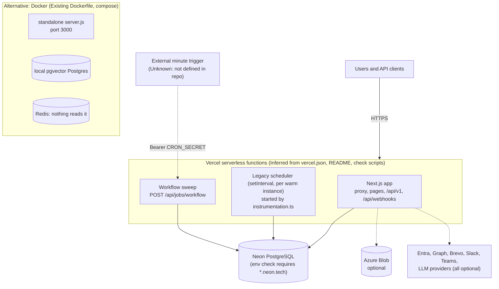

# Deployment and runtime

Build, CI, hosting, configuration, background execution, scaling behaviour and test strategy. Labels: **Existing**, **Inferred**, **Proposed**, **Unknown**. Interactive diagrams: [deployment](diagrams/deployment.architecture.html) (configuration chooses the runtime shape) and [background](diagrams/background.architecture.html).

## Build and packaging

| Item | Existing | Evidence |
|---|---|---|
| Framework | Next.js 16.3.7 App Router, React 19.0.0, TypeScript 5.9.3 (`strict`, target ES2022, `@/*` path alias) | `package.json`, `package-lock.json`, `tsconfig.json` |
| Styling | Tailwind CSS 4 through `@tailwindcss/postcss`; Inter font via `next/font/google` | `postcss.config.mjs`, `src/app/layout.tsx` |
| Scripts | `dev`, `build`, `start`, `lint` (`eslint . --max-warnings=0`), `typecheck`, `test` (`vitest run`), `db:*`, `environment:check`, `security:check`, `agent-tools:check`, `graph:build`, `architecture:render` | `package.json` |
| `postinstall` | `prisma generate` | `package.json` |
| Vercel build | `vercel-build` = `npm run environment:check && next build`; the build fails on an unsafe production environment | `package.json`, `vercel.json` |
| Output mode | `standalone` everywhere except on Vercel (`VERCEL=1`), where it is left to Vercel's adapter because Next 16.3 omits a trace file standalone finalisation expects | `next.config.mjs` |
| Server externals | `@prisma/client`, `.prisma/client`, `bullmq`, `ioredis`, `pdfkit`. `bullmq` and `ioredis` are not dependencies and are not imported. | `next.config.mjs`, `package.json` |
| Tracing | `pdfkit` font data included for `/api/v1/reports` | `next.config.mjs` |
| Docker image | Three stages on `node:22-alpine` (deps, builder with `prisma generate` and `npm run build`, runner); non-root user; copies `.next/standalone`, static assets, Prisma files and the two check scripts; `CMD` runs the environment check then `node server.js` on port 3000 | `Dockerfile` |
| Local infra | `docker-compose.yml`: `pgvector/pgvector:pg16` and `redis:7-alpine` with volumes and a Postgres health check | `docker-compose.yml` |

## CI

`.github/workflows/ci.yml`, on pushes to `main` and on pull requests, one job on `ubuntu-latest` with Node 22 and npm cache:

1. `npm ci`
2. `npx prisma generate`
3. `npm run agent-tools:check`
4. `npm run typecheck`
5. `npm run lint`
6. `npm test`
7. `npm audit --omit=dev`
8. `npm run build` with `AUTH_SECRET=ci-build-secret`

**Existing: no deploy job and no database in CI.** Deployment is by Vercel's git integration (**Inferred**: `AGENTS.md` says "commit and push" publishes to `origin/main`, "triggering Vercel"; the Vercel project itself was not inspected). **Documented, not verified:** `docs/IMPLEMENTATION_STATUS.md` (latest entry 2026-09-30) records that GitHub Actions runs did not start because of an account billing lock and tells readers not to describe CI as green; its current state is **Unknown**. The same document records that Vercel Preview builds fail the production environment preflight on purpose and that `main` Production was Ready. Integration against real PostgreSQL is manual: `scripts/verify-workflow-postgres.ts`, `scripts/manual-verification/*.mjs`, `scripts/e2e-smoke.ps1`, `scripts/verify-production-schema.sql`. **Unknown** whether they are run routinely.

## Tests

| Aspect | State |
|---|---|
| Runner | Vitest 4.1.11, Node environment, `tests/**/*.test.ts`, path aliases resolved |
| Size | 50 files, about 6,400 lines, 298 `it`/`test` calls |
| Data | `DATA_DRIVER=memory`, `DATA_DIR=.data-test`: tests never touch a real database |
| Coverage areas (by file name) | access control and tenant isolation, API keys and routes, audit chain, automation, assignment, SLA and pause, escalation, attachments, email ingest and threading, webhooks, workflow concurrency, delivery and monitoring, OpenAPI shape, pagination, priority, production environment and schema verification, soft delete, sign-in |
| Not covered | No browser or component tests (no Playwright, no React Testing Library in `package.json`); UI behaviour is untested by automation. A Prisma-backed run is not part of the suite (`tests/prismaStore.test.ts` exists; what it mocks was not audited). |
| Executed in this audit | **No.** The suite, type-check, lint and build were not run. |

## Runtime topology

**Existing** versus **Inferred**: the container path (Dockerfile, compose) is Existing. The Vercel plus Neon path is Inferred from `vercel.json`, the Vercel link in `README.md`, the Neon-only database check and Neon comments in `prismaStore.ts` and `databaseBlob.ts`. The real project settings, regions, plan, environment values and any dashboard-defined cron are **Unknown**.

## Configuration

Environment variables are read once in `src/server/config.ts` (and a few places directly). They fall into these groups; values are never committed.

| Group | Variables |
|---|---|
| Data | `DATA_DRIVER`, `DATABASE_URL`, `DIRECT_URL`, `DATA_DIR` |
| Auth | `AUTH_SECRET`, `AUTH_URL`, `AUTH_MICROSOFT_ENTRA_ID_ID`, `_SECRET`, `_ISSUER`, `DEMO_MODE`, `PUBLIC_DEMO_AUTH`, `LOCAL_ACCOUNT_AUTH` |
| Email | `EMAIL_PROVIDER`, `MS_GRAPH_TENANT_ID`, `_CLIENT_ID`, `_CLIENT_SECRET`, `SUPPORT_MAILBOX`, `BREVO_API_KEY`, `BREVO_INBOUND_SECRET`, `BREVO_SENDER` |
| Chat and webhooks | `WEBHOOK_SECRET`, `ZENDESK_WEBHOOK_SECRET`, `FRESHDESK_WEBHOOK_SECRET`, `SLACK_SIGNING_SECRET`, `SLACK_WEBHOOK_URL`, `TEAMS_WEBHOOK_URL`, `TEAMS_PRESENCE_CONNECTIONS` |
| AI | `LLM_PROVIDER`, `AZURE_OPENAI_*` (endpoint, key, chat and embedding deployments, API version), `GEMINI_API_KEY`, `GEMINI_MODEL`, `GROQ_API_KEY`, `GROQ_MODEL`, `RESOLVE_AUTO_THRESHOLD` (0.78), `RESOLVE_SUGGEST_THRESHOLD` (0.55) |
| Storage | `AZURE_STORAGE_CONNECTION_STRING`, `ATTACHMENTS_CONTAINER`, `ATTACHMENT_STORAGE`, `ATTACHMENT_MAX_BYTES` |
| Jobs | `CRON_SECRET`, `SCHEDULER_INTERVAL_MS` (default 300000), `APP_BASE_URL` |
| Observability | `SENTRY_DSN` (inert) |
| Declared, unused | `REDIS_URL` |

`.env.example` lists only `DATA_DRIVER`, `DATABASE_URL`, `GEMINI_API_KEY`, `AUTH_SECRET`; `.env.production.example` covers the production set. Neither was found to document every variable above (the table is derived from code).

## Background execution

**Existing.** Two independent runners:

1. **Legacy scheduler** (`src/server/jobs/scheduler.ts`). `register()` in `instrumentation.ts` calls `startScheduler()` once per Node process. After 15 s and then every `SCHEDULER_INTERVAL_MS` (5 minutes) it runs `tick()` under `withJobLock("scheduler-tick")`: an in-process mutex plus a Postgres advisory lock (`pg_advisory_lock` through `$queryRawUnsafe` with a computed integer key) when the Prisma driver is active. Steps, each in `runWithRetry` (2–3 attempts, exponential backoff, final failure written to the audit chain as `job.failed`): SLA sweep (80% warning, breach escalation), auto-close of resolved tickets after 7 days, Monday digest, monthly PDF report, outbound callback retries, Graph mailbox poll. It **skips tickets in the bucket workflow**. On hosts without `VERCEL` it also calls `runWorkflowMaintenance("local_scheduler")` every 60 s.
2. **Workflow maintenance** (`jobs/workflowMaintenance.ts`, `durableLease.ts`, `app/api/jobs/workflow/route.ts`). `POST /api/jobs/workflow` with a bearer `CRON_SECRET` (≥32 chars, constant-time compare, `maxDuration` 60 s). Under a durable `JobLease` (120 s) it walks tickets by an id cursor for about 20 s, raising queue warnings, manager and senior-RM escalations, resolution escalations and the 7-day no-response closure; then trims workflow metadata, drains up to 20 outbox deliveries, and retries one callback.

**Gap (Inferred, with a verified half).** The repository defines no caller for runner 2 on serverless hosting (`vercel.json` has no `crons`). `docs/SERVICE_DESK_WORKFLOW.md:108-123` says to create a one-minute cron-job.org POST with the bearer secret and states that "Vercel does not guarantee in-process timers"; `docs/IMPLEMENTATION_STATUS.md` records that the release did not configure that account and that it must be enabled before an organization opts in to the workflow. So the maintainers know of the gap; whether the schedule exists is **Unknown**. Runner 1 has no HTTP trigger at all; on serverless its `setInterval` advances only while an instance happens to be warm, and the same document describes the digest and mail-poll timers as a separate mechanism the endpoint does not replace. Workflow-bucket escalations, outbox delivery and SLA breach escalation therefore depend on an external schedule that this audit could not confirm. See [risks V2](risks-and-recommendations.md#v2-nothing-in-the-repository-schedules-background-work-on-serverless).

## Scaling and performance behaviour

| Concern | Existing behaviour | Effect |
|---|---|---|
| Process state | Store singleton, event bus, rate-limit windows, in-process job lock live on `globalThis` | Correct in one instance; per-instance on many: live updates missed across instances, limits multiplied, locks rely on Postgres |
| Live updates | `EventEmitter` with `setMaxListeners(500)`, one listener per SSE connection; four client call sites each open `EventSource`, so a tab can hold several streams | Connection count per user is above one; long-lived responses on serverless are subject to platform duration limits (**Unknown** here) |
| Tenant scans | `listTickets(tenant.id)` with default options and `count` for every tenant each tick; `users.list({ tenantId })` per intake and per notification | Cost grows with data; no index-assisted lookup by email through the port |
| Search | All published articles of the tenant loaded and ranked in process per query; stale embeddings re-embedded inline | Latency and memory grow with article count; the pgvector index is unused |
| Request path | Intake runs classification, tagging, triage and retries inside the HTTP request | Request latency depends on LLM providers (timeouts exist; request `maxDuration` is not set on these routes, platform default applies, **Unknown**) |
| Transactions | Serializable isolation with up to three retries | Safe; contention on `AuditRecord (tenantId, index)` serialises audit writes per tenant |
| Outbox and callbacks | Claimed by compare-and-set with leases; at-least-once | Duplicates possible by design |
| Memory driver | Rewrites whole dataset per mutation | Demo only; production gate forbids it |
| Caching | None | Every request recomputes; only `no-store` fetches |

No load test, profile or production metric was available: all of the above are properties of the code, not measurements. **Documented, not verified:** `docs/IMPLEMENTATION_STATUS.md` records production counts of 2 organizations, 13 users, 26 tickets and 205 audit records at the 2026-09-30 release, which suggests the scale concerns are prospective rather than current. **Unknown:** present traffic and cold-start times.

## Observability

- Logs: one redacted JSON line per event to stdout/stderr (`logger.ts`); the platform's log pipeline is **Unknown**.
- Metrics and traces: none found. `GET /api/v1/health` returns driver, auth mode and feature flags; its `version` is hard-coded `2.0.0`.
- Errors: Sentry is declared but inert; job failures and exhausted retries are recorded in the audit chain, which is visible in `/audit`.
- Operational endpoints: `GET /api/v1/workflow/alerts`, `workflow/board`, `workflow/retry-emails` give staff queue health and a manual outbox retry.

## Operational runbook gaps

- Backup and restore, migration rollout order and secret rotation: **no document found** in `docs/`. Cron setup is documented in `docs/SERVICE_DESK_WORKFLOW.md:108-123`, and `docs/IMPLEMENTATION_STATUS.md` records activation and rollback steps for the workflow release. The workflow sweep's error text refers to a "runbook" (`workflowMaintenance.ts` logs "See deployment logs and runbook") that was not located as a separate file.
