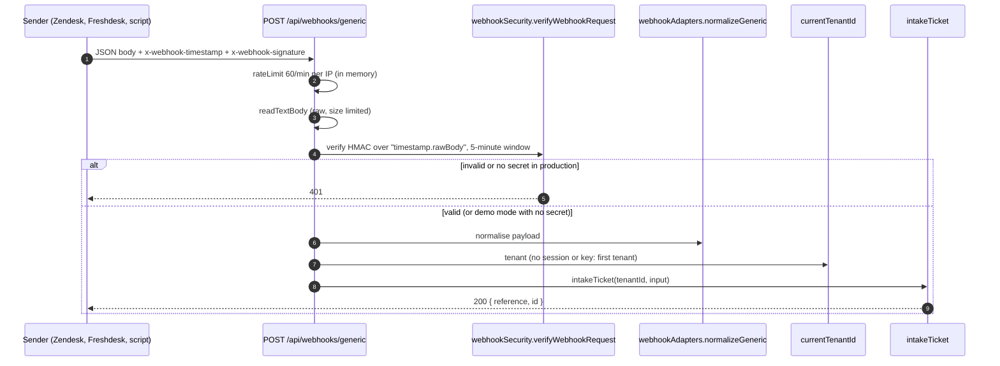

# Security architecture

Authentication, authorization, tenant isolation, inbound and outbound trust, secrets and the gaps found. Labels: **Existing**, **Inferred**, **Proposed**, **Unknown**. Interactive diagrams: [auth-flow](diagrams/auth-flow.sequence.html) (sequence) and [identity](diagrams/identity.architecture.html) (components). Findings are ranked in [risks-and-recommendations.md](risks-and-recommendations.md); nothing here is a penetration test, and no code was executed.

## Authentication

### Modes

`resolveAuthMode` in `src/server/config.ts` derives one of seven modes from four environment inputs.

| Mode | When | Browser sign-in | API |
|---|---|---|---|
| `demo` | `DEMO_MODE` true, which is the **default** unless Entra ID is configured | Passwordless credentials provider `demo` for seeded users | Header fallbacks (`x-actor`, `x-tenant`), seeded admin, open webhooks |
| `public-demo` | `PUBLIC_DEMO_AUTH=true`, no Entra | Passwordless, but only the six allow-listed emails in the internal tenant (`src/shared/publicDemoUsers.ts`) | API keys only; no header fallbacks |
| `organization` | `LOCAL_ACCOUNT_AUTH=true` | Organization code, email and password | API keys |
| `entra`, `entra+organization`, `public-demo+organization` | Combinations | Microsoft Entra ID OIDC (and password if enabled) | API keys |
| `api-key-only` | Nothing configured, demo off | None | API keys |

**Existing.** `docs/IMPLEMENTATION_STATUS.md` (Known Issues) records that passwordless sign-in for the six approved demo identities is an "owner-approved showcase risk" on the hosted app, to be disabled before private SSO. Sign-in uses Auth.js v5 beta (`next-auth` 5.0.0-beta.32) with a **JWT session strategy** and `trustHost: true` (`src/auth.config.ts`). The token carries `userId`, `role` and `tenantId`. There is no server-side session table, so a session cannot be revoked server-side before it expires (**Inferred** from the strategy; session lifetime and cookie flags are Auth.js defaults, not set in the repository, **Unknown** in practice).

`src/auth.ts` refuses to load in production without an `AUTH_SECRET` of at least 32 characters; in demo mode it generates a random per-process secret rather than using a committed fallback. Sign-in and sign-out events are appended to the audit chain.

### Organization passwords and account links

`src/server/services/accountAccessService.ts` and `src/server/auth/passwords.ts`:

- scrypt hashing (N=16384, r=8, p=1, 64-byte key), minimum 12 and maximum 128 characters.
- Lockout after 5 failed attempts for 15 minutes; the same generic error for unknown organization, email or password.
- Setup and reset links: a random token (the setup route accepts only tokens of 32 or more characters) whose **hash** is stored, 24-hour expiry, delivered with `sendSensitiveEmail`, which deliberately does not persist the body or log it. If no email provider exists the one-time link is shown to the administrator.
- Public token routes (`/api/account/setup`, `/api/account/ticket-confirmation`) are rate limited (10/min in memory; DB-backed `sharedActionLimit` fails closed if `AUTH_SECRET` is short).

### API keys

`src/server/auth/apiKeys.ts`: `nlk_` plus 43 base64url characters, shown once, stored as a SHA-256 hash; verified in constant time; bound to one tenant, a role (`agent` by default, or requester-scoped `requester` / `ticket_submitter` with a bound active requester), optional expiry and optional webhook URL. Creation, rotation and deletion are audited. A key that is presented but invalid never falls back to a privileged identity. Keys cannot impersonate.

### Webhook callers

Webhook routes are outside the proxy and authenticate themselves; see [Inbound webhooks](#inbound-webhooks).

## Authorization

### Role and permission matrix

`src/server/auth/rbac.ts`: six roles, 21 permissions. `can(role, permission)` returns false for unknown roles, so the anonymous sentinel has nothing.

| Role | Permissions (cumulative) |
|---|---|
| `ticket_submitter` | `ticket.read`, `ticket.create` (API-only integrations) |
| `requester` | `ticket.read`, `ticket.create`, `kb.read` |
| `agent` | requester set + `ticket.write`, `ticket.assign`, `ticket.resolve`, `kb.write`, `problem.read/write`, `change.read/write`, `asset.read/write`, `automation.read`, `audit.read`, `report.read` |
| `manager` | agent + `change.approve`, `ticket.dispatch`, `ticket.delete` |
| `tenant_admin` | manager + `automation.write`, `admin` |
| `super_admin` | every permission (wildcard) |

Record-level rules sit on top: requesters see only their own tickets and public articles; internal notes are agent-only; SSE events are filtered per user; bucket workflow actions require an active staff account in the same tenant and a role or group membership appropriate to the phase.

### Where authorization is applied

- 71 of 118 handlers call `requirePermission(req, "<permission>")` (some also inline-check). 27 handlers check inline with `can(actor.role, …)` after `actorContext`. The remainder are token or signature authenticated, public probes, or role-checked in the handler body (`organizations` create requires `super_admin`).
- The two styles differ on invalid keys: `requirePermission` answers **401** for a presented, invalid API key and 403 otherwise; the inline style answers 403 for both. See [risks V10](risks-and-recommendations.md#v10-two-authorization-idioms-give-different-status-codes).
- **Impersonation.** `x-impersonate` lets `manager`, `tenant_admin` or `super_admin` act as another active user in their own tenant whose role rank is not higher; API keys cannot (`context.ts` `currentActor`). Whether an impersonated action is distinguishable in the audit chain was **not verified**: the actor object carries `impersonating: true`, but it was not traced into audit payloads.

## Tenant isolation

**Existing mechanism.** The tenant comes only from the session or API key (`currentTenantId`). Every `listTickets(tenantId, …)` adds it to the filter. For records addressed by id, `loadTicket` and `assertTenant` compare the row's `tenantId` with the caller's and return **404** on mismatch. Services re-check where a client could supply an id from another tenant (for example intake ignores a catalog item from another tenant; workflow transitions verify the assignee and manager belong to the tenant).

**Gaps and risks.**

1. **Ten models have no `tenantId`** (children such as `TicketMessage`, `Approval`, `Attachment`, `Resolution`). Isolation relies on every path loading the tenant-scoped parent first. There is no database enforcement (row-level security or composite keys). **Inferred risk**, no counter-example found in the paths read.
2. **Channels route to the first tenant.** Webhooks, Graph and Brevo mail, Slack and Teams carry no tenant. `currentTenantId` falls back to `tenants[0]` and `defaultTenantId()` does the same. In a multi-tenant deployment every inbound channel ticket lands in one tenant, and "first" depends on the order the store returns (no `orderBy` on `tenants.list()`). **Verified**, [V3](risks-and-recommendations.md#v3-inbound-channels-have-no-tenant-routing).
3. **Cross-tenant reads by superusers** (`super_admin`) are by design (`organizations` GET without scope).

## Inbound webhooks

Per source: **generic**, **Zendesk**, **Freshdesk** use HMAC with `WEBHOOK_SECRET` or a per-source secret (`timingSafeEqual`); **Slack** uses Slack's v0 signature with `SLACK_SIGNING_SECRET`; **Brevo** uses a shared secret in `?token=` or `x-brevo-secret` compared with `===`. Without a configured secret, demo mode accepts the request and production rejects it. A non-constant-time comparison and a secret in a URL are [V7](risks-and-recommendations.md#v7-brevo-inbound-secret-compared-non-constant-time-and-placed-in-the-url).

## Outbound trust

- **Callbacks** (`integrationWebhookService.ts`): HMAC-signed, 5-second timeout, `redirect: "error"`, URL host resolved with `dns.lookup` and refused if any address is private or loopback (`isPrivateAddress`, `assertPublicTarget`), at-least-once with retries. This is a strong SSRF control. **Inferred** residual risk: DNS rebinding between the check and the connection is not addressed by the code read.
- **LLM providers.** Keys stay server-side; ticket and article text is sent to the provider. No redaction or per-tenant opt-out exists in `src/server/ai`. **Existing**, listed as a privacy consideration, not a defect.
- **Graph and Brevo.** Credentials in environment variables only; token fetches use 5–10 s timeouts and `redirect: "error"`.

## Transport, headers and browser controls

`next.config.mjs` sets for all paths: `X-Frame-Options: SAMEORIGIN`, `X-Content-Type-Options: nosniff`, `Referrer-Policy: strict-origin-when-cross-origin`, a restrictive `Permissions-Policy`, `Strict-Transport-Security` (2 years, includeSubDomains, preload), `X-DNS-Prefetch-Control: off`, and a CSP with `default-src 'self'`, `connect-src 'self'`, but `script-src 'self' 'unsafe-inline' 'unsafe-eval'`. The permissive script policy weakens the CSP's XSS protection; it is probably needed for Next.js inline scripts without a nonce set-up (**Inferred**).

There is no explicit CSRF token or `Origin` check on cookie-authenticated JSON routes (`grep` for origin checks in `guards.ts`, `http.ts`, `proxy.ts` found none outside the redirect URL). Auth.js protects its own endpoints. **Potential risk, not verified**: protection for the product API then depends on cookie `SameSite` defaults and on browsers not sending cross-site `application/json` requests without a preflight. `tests/cors.test.ts` covers the gateway decision only.

## Data protection

- **Secrets in logs.** `logger.ts` redacts by key name (authorization, cookie, password, secret, token, api key, connection string, webhook URL, DSN) and by pattern (`Bearer …`, `nlk_…`, URL credentials, `AccountKey=`, `?token=`). It truncates strings at 4,096 characters.
- **Secrets at rest.** `.gitignore` excludes `.env*` except `*.example`. Only hashes of API keys, passwords and access tokens are stored. Webhook signing secrets are derived per key by `webhookSigningSecret` (**Inferred**: from the key's stored hash or a server secret; not traced).
- **Uploads.** MIME allow-list, blocked extensions, size cap, filename sanitising, opaque blob keys validated by `validateBlobKey`; downloads force `Content-Disposition: attachment` with `nosniff` (`attachments/[id]/route.ts`). Content scanning for malware: **none found**.
- **Audit.** Hash-linked per-tenant chain; a verify endpoint. The chain proves internal consistency, not authenticity: someone with database write access who recomputes every later hash could rewrite it (**Inferred**; there is no external anchor).

## Production gates

`npm run environment:check` (also `prestart`, `vercel-build`, and the Docker entrypoint) runs `scripts/check-production-environment.cjs` and `check-production-security.cjs`, which fail the process unless: `DEMO_MODE=false`; `AUTH_SECRET` is a non-placeholder with enough diversity; `DATA_DRIVER=prisma`; `DATABASE_URL` is a real Neon host with `sslmode=require`; Entra settings are complete UUID or HTTPS-issuer values when present; Azure storage strings are well-formed HTTPS public-cloud; database attachment mode is consistent. This is a strong deployment control that most demo-grade apps lack.

## Controls summary

| Control | State | Evidence |
|---|---|---|
| Authentication on pages and API | Present; API key not verified at the proxy, verified in route context | `proxy.ts`, `context.ts` |
| RBAC | Present, two idioms | `rbac.ts`, `guards.ts` |
| Tenant scoping | Present in code paths; no database-level enforcement | `guards.ts`, `ticketService.ts` |
| Input validation | zod on most writes; body size cap; server-owned fields stripped | route files, `http.ts` |
| Rate limiting | In-memory per instance, plus DB-backed on public token routes | `rateLimit.ts`, `sharedRateLimit.ts` |
| Brute-force protection | Account lockout; generic errors | `accountAccessService.ts` |
| Webhook authentication | HMAC with replay window; Slack v0; Brevo shared secret | `webhookSecurity.ts` |
| SSRF protection | Present on outbound callbacks | `integrationWebhookService.ts` |
| Security headers | Present; CSP permissive for scripts | `next.config.mjs` |
| Audit trail | Hash chain, transactional, verifiable | `auditChain.ts` |
| Secrets hygiene | Redacting logger, ignored env files, production gates | `logger.ts`, `.gitignore`, `scripts/*` |
| Dependency scanning | `npm audit --omit=dev` in CI (output not seen) | `.github/workflows/ci.yml` |
| Error monitoring | Declared (Sentry), **not active** | `logger.ts` |
| CSRF defence beyond cookie defaults | Not found | n/a |
| Malware scanning of uploads | Not found | n/a |
