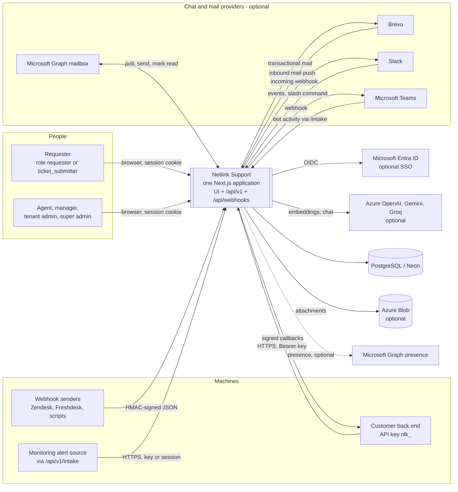

# System context

Actors, dependencies and external services. Everything here is **Existing** unless marked. Interactive diagrams: [landscape](diagrams/landscape.architecture.html) and [integrations](diagrams/integrations.architecture.html).

## Actors

| Actor | How they reach the system | Evidence |
|---|---|---|
| Requester | Browser, Auth.js session. Sees only their own tickets and public knowledge-base articles. Roles `requester`, `ticket_submitter`. | `src/server/auth/rbac.ts` (`REQUESTER`, `TICKET_SUBMITTER`), `src/app/api/v1/events/route.ts` (requesters receive only their own events) |
| Agent | Browser. Works tickets, knowledge base, problems, changes, assets; permissions `ticket.write`, `ticket.assign`, `kb.write` and others. | `rbac.ts` `AGENT` |
| Manager | Agent plus `change.approve`, `ticket.dispatch`, `ticket.delete`; operates the dispatcher board and bucket workflow. | `rbac.ts` `MANAGER` |
| Tenant admin | Manager plus `automation.write` and `admin`: users, groups, SLA, API keys, workflow settings. | `rbac.ts` `TENANT_ADMIN` |
| Super admin | Every permission; the only role that creates or lists all organizations. | `rbac.ts` (`"*"`), `src/app/api/v1/organizations/route.ts` |
| API-key integrator | A customer server using `Authorization: Bearer nlk_…` or `x-api-key`. Acts with the key's role in the key's tenant; can be requester-scoped. | `src/server/auth/apiKeys.ts` |
| Webhook sender | Zendesk, Freshdesk or an internal script posting signed JSON. | `src/app/api/webhooks/*/route.ts`, `src/server/channels/webhookAdapters.ts` |
| Scheduler and cron | The app's own timers, plus an external caller of `POST /api/jobs/workflow`. `docs/SERVICE_DESK_WORKFLOW.md:108` documents cron-job.org as that caller; `docs/IMPLEMENTATION_STATUS.md` says the 2026-09-30 release did not configure it. Whether it runs today is **Unknown**. | `src/instrumentation.ts`, `src/app/api/jobs/workflow/route.ts` |

## External services

Every external capability is optional and switched on by configuration (`src/server/config.ts`). The "if absent" column is the fallback the code implements.

| Service | Purpose | Transport and credential | If absent | Evidence |
|---|---|---|---|---|
| PostgreSQL | System of record (34 models) | Prisma over `DATABASE_URL` (+ `DIRECT_URL`) | Memory store with `.data/store.json` (demo, tests) | `src/server/data/index.ts`, `prisma/schema.prisma` |
| Microsoft Entra ID | Browser SSO | OIDC; `AUTH_MICROSOFT_ENTRA_ID_*` | Demo, public-demo or organization password sign-in, or API-key-only | `src/auth.ts`, `config.resolveAuthMode` |
| Microsoft Graph (mail) | Poll a support mailbox; send mail | OAuth client-credentials to `login.microsoftonline.com`, then Graph v1.0; `MS_GRAPH_*`, `SUPPORT_MAILBOX` | No inbound polling; mail recorded in-app only | `src/server/channels/graphEmail.ts`, `src/server/notify/notifier.ts` |
| Brevo | Inbound parsing (push) and transactional mail | Webhook with shared secret; API key for sending | Same as above | `src/server/channels/brevoEmail.ts`, `src/app/api/webhooks/brevo/route.ts` |
| Slack | Inbound events and slash command; outbound incoming webhook | Slack v0 signing secret; `SLACK_WEBHOOK_URL` | Channel disabled | `src/server/channels/slack.ts` |
| Microsoft Teams | Bot activity in; notification webhook out; optional presence for dispatch | Authenticated `/api/v1/intake`; `TEAMS_WEBHOOK_URL`; `TEAMS_PRESENCE_CONNECTIONS` | Channel disabled | `src/server/channels/teams.ts`, `src/server/integrations/teamsPresence.ts` |
| Azure OpenAI, Gemini, Groq | Classification, summaries, grounded answers, embeddings | HTTPS with provider key, order set by `LLM_PROVIDER` then Azure, Gemini, Groq | Offline rules-based classifier, template answer and hashed embeddings | `src/server/ai/llm.ts`, `embeddings.ts`, `aiService.ts` |
| Azure Blob Storage | Attachment bytes | `AZURE_STORAGE_CONNECTION_STRING` | Database storage if requested with Postgres; local disk in demo; otherwise attachments disabled | `src/server/storage/blobStore.ts`, `azureBlob.ts`, `databaseBlob.ts` |
| Customer callback URLs | Signed `ticket.created` and `ticket.updated` events | HTTPS POST, HMAC `X-Netlink-Signature`; private addresses and redirects refused | No callbacks unless a key sets a webhook URL | `src/server/services/integrationWebhookService.ts` |
| Vercel | Hosting and build | `vercel.json`, `vercel-build` script | Docker image alternative | `vercel.json`, `next.config.mjs` |
| Neon | Production Postgres host | `DATABASE_URL` host must end `.neon.tech` or the environment check fails | n/a | `scripts/check-production-environment.cjs` |
| Redis | Provisioned in compose and read in config; **no code uses it** | n/a | n/a | `docker-compose.yml`, `src/server/config.ts` |

**Inferred.** The hosted showcase is Vercel plus Neon: `README.md` links `netlink-support.vercel.app`, `vercel.json` sets the build, the environment check demands a Neon host, and `databaseBlob.ts` mentions Neon quota. The actual project settings are **Unknown**.

## Trust boundaries

1. **Browser to server.** The browser is untrusted. All state changes go through `/api/v1` and are authorised server-side. No client component imports server runtime code (verified by script: 0 `"use client"` files import a server module at runtime; type-only imports exist).
2. **Server to durable state.** Only the DataStore port and `databaseBlob.ts` reach the Prisma client.
3. **Server to third parties.** Ticket and knowledge-base text can leave the system to the chosen LLM provider. No redaction step exists in `src/server/ai` (searched for it; none). Credentials stay server-side and the logger redacts bearer tokens, `nlk_` keys, connection strings and secret-named fields (`src/server/observability/logger.ts`).
4. **Third parties to server.** Webhook routes authenticate by signature or shared secret, not by session. They are outside the proxy (its matcher excludes `/api` except `/api/v1/*` and the demo callback).
5. **Tenant boundary** (logical, inside one database): described in [security-architecture.md](security-architecture.md#tenant-isolation).

## Context-level concerns

- **One tenant for non-request channels.** Webhooks, email, Slack and Teams carry no tenant. They resolve it with `currentTenantId()` or `defaultTenantId()`, which fall back to the first tenant returned by `store.tenants.list()`. Multiple tenants cannot receive inbound channel traffic separately. **Existing**, see [risks](risks-and-recommendations.md#v3-inbound-channels-have-no-tenant-routing).
- **Email provider is exclusive.** `EMAIL_PROVIDER` selects Brevo, Graph or none, and flips inbound between push and poll. Using both at once is not supported (`config.emailProvider`).
- **Data egress to LLMs** is enabled automatically when a provider key is present; there is no per-tenant switch (`autoResolve` only controls triage actions, not classification).
